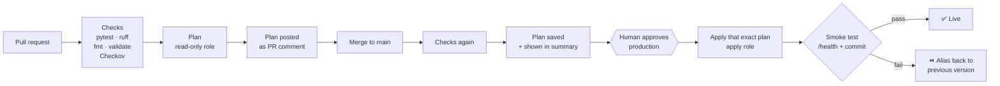
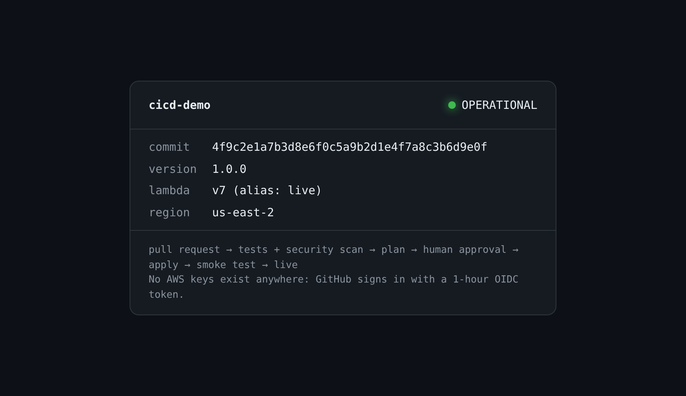

# CI/CD Pipeline — Project 10

GitHub Actions → AWS with **no access keys anywhere**, a **human approval gate** before production, and **automatic rollback** when a deploy goes bad.

Every change follows one path: pull request → tests, lint and security scan → Terraform plan posted on the PR → merge → the same checks again → plan saved → **approve in GitHub** → apply exactly that plan → smoke test the live URL → done, or rolled back by itself.





## What makes it production-grade

| | How |
|---|---|
| **No stored credentials** | GitHub proves its identity with a signed OIDC token; AWS returns 1-hour credentials. There are no access keys to leak, rotate or forget. |
| **Two roles, split by risk** | Pull requests and main get a **read-only plan role**. Only jobs in the `production` environment, which a human must approve, can assume the **apply role**. GitHub sets the token's `sub` claim, so a workflow can't fake it. |
| **Least privilege by name** | Both roles can only touch resources named `cicd-demo*`. The plan role can take the state lock but never rewrite the state itself. |
| **No privilege escalation** | Any IAM role the pipeline creates **must** carry a permissions boundary that allows only logging and tracing. The classic attack, "create an admin role and pass it to a Lambda", is denied by IAM itself. |
| **You approve what gets applied** | The plan is saved as an artifact and shown in the run summary. The apply job applies that file, not a fresh plan that could differ. |
| **Instant rollback** | Every deploy publishes an immutable Lambda version behind a `live` alias. If the smoke test fails, the alias points back at the previous version in about a second, with no rebuild. |
| **The smoke test checks the right thing** | It's not enough that `/health` returns 200. It must also be serving **this commit**, which catches a deploy that "succeeded" but didn't actually ship. |
| **Security scanned** | Checkov scans the Terraform and the workflow files on every run. Each accepted finding is skipped inline with its reason, so the scan stays at zero failures. |
| **Safe concurrency** | One deploy at a time; a running deploy is never cancelled halfway. Terraform state is locked with S3's native lock file. |
| **Forks get nothing** | Pull requests from forks run the checks but never get AWS credentials. |
| **Kept current** | Dependabot updates the Actions, Terraform providers and Python tools weekly. |

## Watch it roll itself back

1. Open a pull request that changes `service/deploy.auto.tfvars` to `simulate_bad_deploy = true`.
2. CI passes and the plan comment shows the change. Merge it and approve the deploy.
3. Apply succeeds, then the smoke test gets `503` from `/health`.
4. The pipeline points `live` back at the last good version, re-checks it's healthy, and marks the run failed with a **⏪ Rolled back** summary.
5. The site never stayed down. Fix forward with a new pull request.

## Layout

```
bootstrap/        run once by hand: GitHub OIDC provider, plan + apply roles, boundary, state bucket
service/          what the pipeline deploys: Lambda (versions + live alias) behind an HTTP API
  src/app.py        status page + /health, reports the live commit
  tests/            unit tests
  deploy.auto.tfvars  release settings (version, rollback demo switch)
scripts/smoke_test.sh  post-deploy check, also used to confirm a rollback worked
.github/workflows/
  checks.yml      shared gate: tests, lint, fmt/validate, Checkov (no AWS access)
  ci.yml          pull requests: checks → plan → PR comment
  deploy.yml      main: checks → plan → approval → apply → smoke test → auto-rollback
```

## Set it up (about 15 minutes)

**1. Bootstrap, once, from your machine with your admin profile**
```powershell
cd bootstrap
copy terraform.tfvars.example terraform.tfvars   # check owner/repo; create_oidc_provider=false if one exists
terraform init
terraform apply                                  # 12 resources
terraform output -raw gh_commands                # the 4 GitHub variables, ready to paste
```

**2. GitHub settings**
- **Variables:** run the four `gh variable set …` lines the output printed, or add them under *Settings → Secrets and variables → Actions → Variables*. They're identifiers, not secrets.
- **Environment:** *Settings → Environments → New environment* `production` → **Required reviewers** → add yourself.
- **Branch protection** (recommended): *Settings → Branches* → protect `main`, require pull requests and the **Checks** status checks.

**3. Ship it.** Push to `main`. The Deploy run pauses at **Review deployments**; approve it, and the summary shows the live URL.

## Cost

About **$0/month**: Lambda, the HTTP API and a few log lines sit inside the free tier, and the state bucket holds kilobytes. GitHub Actions minutes are free for public repos.

## Run the checks locally

```bash
pip install -r requirements-dev.txt
ruff check . && pytest -q
checkov --directory . --framework terraform github_actions --quiet --compact
SMOKE_ATTEMPTS=3 scripts/smoke_test.sh https://<api-url> <commit-sha>
```
